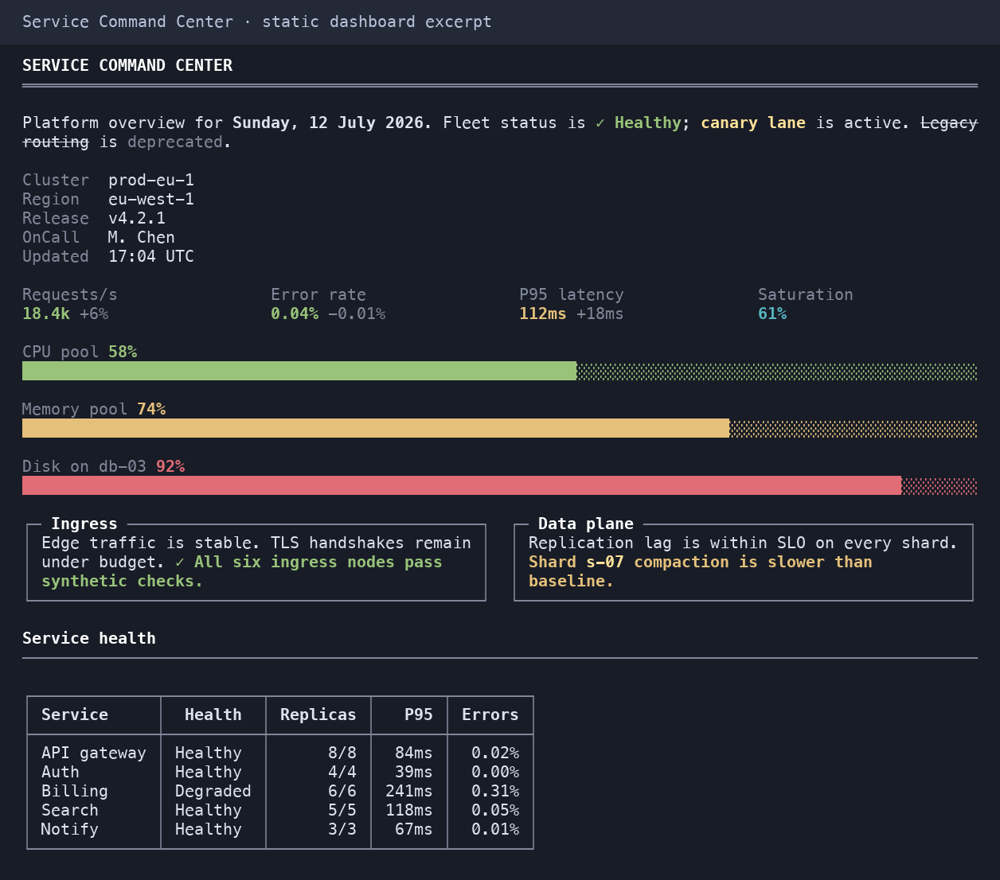
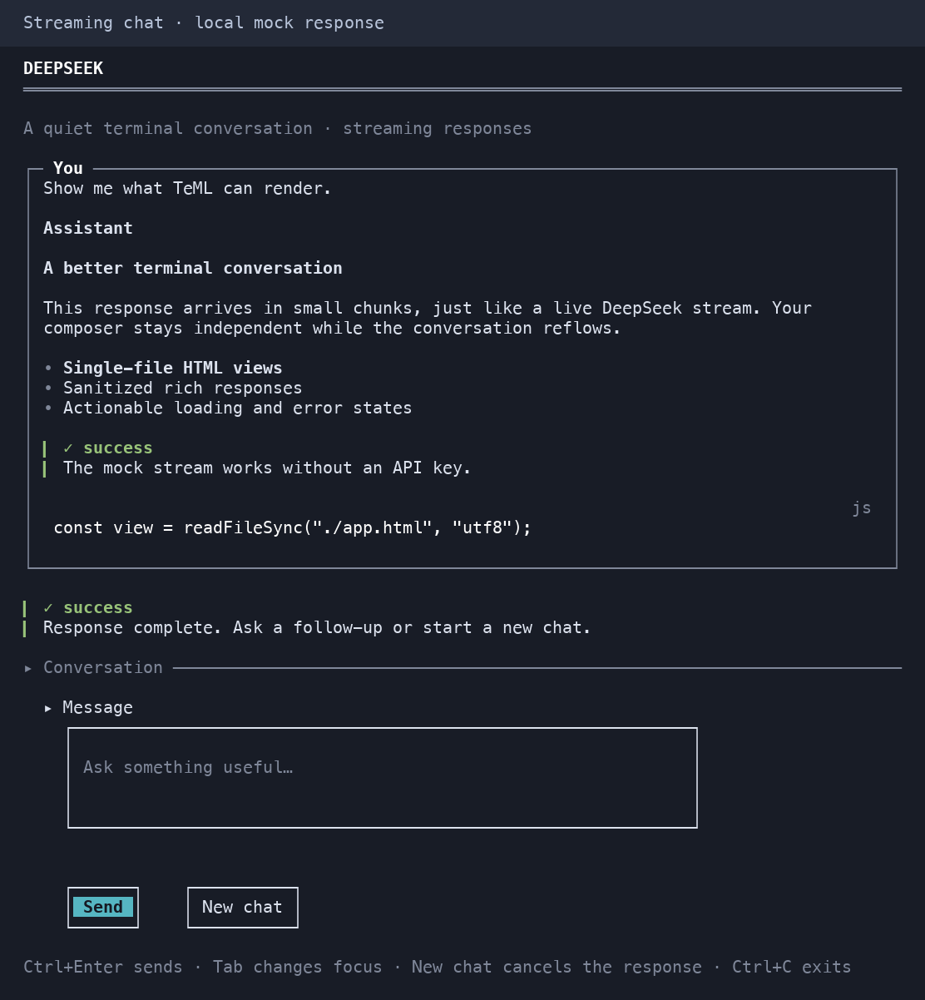
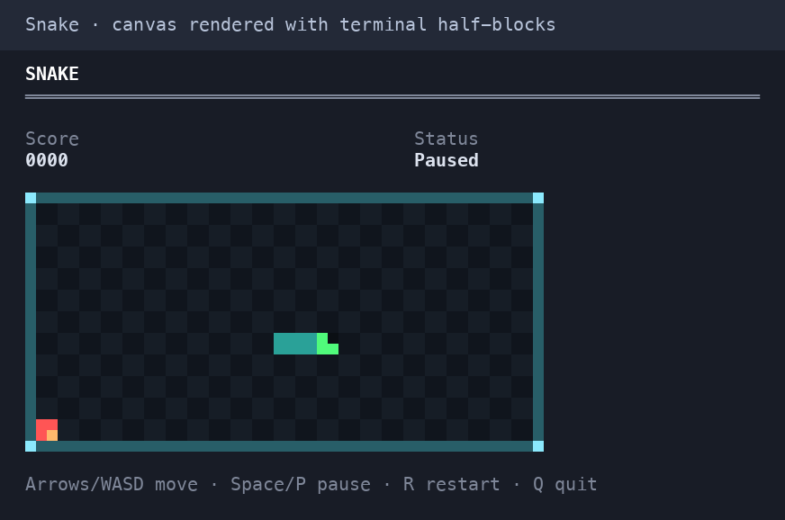

# TeML — Terminal Markup Language

[](https://discord.gg/xGxyM7Nah)

Build readable terminal documents and interactive CLI interfaces from **TeML**,
**Markdown**, or semantic **HTML**.

- **Render a document:** print a file once with `teml view`.
- **Browse documentation:** use `teml read` for full-screen search and navigation.
- **Build an interactive app:** supply a view and event handlers through the Node,
  Rust, Go, or Python host library. TeML handles layout, input, and terminal painting.

This README describes the current source. Published releases may have fewer
features; use [the source setup below](#explore-the-examples) to try the latest examples.

## Demo gallery

Terminal captures rendered from the demos' actual ANSI output. Click an image
for the full-size view. Run these commands after [building the checkout](#explore-the-examples).

| Demo                                                                                                                                                                       | Preview                                                                                                                                                                                       |
| -------------------------------------------------------------------------------------------------------------------------------------------------------------------------- | --------------------------------------------------------------------------------------------------------------------------------------------------------------------------------------------- |
| **Service dashboard** — metrics, progress bars, cards, and a service-health table. Sample data; the image shows the upper section.<br><br>`pnpm run demo:command-center`   | [](docs/images/dashboard.png) |
| **Streaming chat** — rich responses, an editable composer, and compact Send/New chat actions. Captured with the local mock response.<br><br>`pnpm run demo:chat -- --mock` | [](docs/images/chat.png)   |
| **Snake** — a keyboard-controlled canvas game rendered with terminal half-blocks. Shown paused.<br><br>`pnpm run demo:snake-prototype`                                     | [](docs/images/snake.png)                 |

## Install

Requires **Node ≥ 20** and **pnpm ≥ 10**. Install the prebuilt package attached to
the [latest GitHub Release](https://github.com/fogha/teML/releases/latest):

```bash
pnpm add --global https://github.com/fogha/teML/releases/latest/download/teml.tgz
teml --version
```

To pin a release, use its full asset URL, for example
`https://github.com/fogha/teML/releases/download/v0.2.1/teml.tgz`.
These instructions use release assets and do not depend on npm registry publication.

### Host libraries

To drive a terminal interface from your own program, add the host library for your
language. Each one speaks the same protocol to the same engine, so the same
document works from any of them:

```bash
go get github.com/fogha/teml/hosts/go            # Go — resolves from the repository
```

For checkout-based Rust and Python installation, see the
[Rust host guide](crates/teml-host/README.md) and
[Python host guide](hosts/python/README.md). The
[Go host guide](hosts/go/README.md) covers its API and engine discovery.

Rust, Go, and Python hosts start a separate TeML engine: install the CLI above
or point the host at a built checkout. Node apps instead use `teml/interactive`
from their application's local dependency and run the engine in-process; they
do not need a separate global CLI installation.

## Quick start

```bash
teml demo                         # built-in showcase; no files or network needed
teml path/to/document.md          # render TeML, Markdown, or HTML once
teml read path/to/docs/           # full-screen Reader: search, links, and TOC
```

Run `teml --help` for an overview or `teml help <command>` for detailed
behavior, options, keys, and examples. The complete reference is in
[docs/cli.md](docs/cli.md).

`view` prints output and exits; it does not activate buttons or text fields.
`read` requires a real terminal. `teml run` is the NDJSON protocol endpoint for
host programs, not a keyboard-driven app on its own. To try editable forms,
run [one of the interactive examples](#explore-the-examples).

## Library API

Install the same GitHub Release locally in your application:

```bash
pnpm add https://github.com/fogha/teML/releases/latest/download/teml.tgz
```

The snippets below use JavaScript modules. Save them as `.mjs` files and run
them with `node`, or use a project with `"type": "module"`. Interactive snippets
require a real terminal. For APIs not yet included in a release, build a checkout
and install it into your application with `pnpm add /absolute/path/to/teML`.

```js
import { Diagnostics, parseTeml, serializeTeml } from "teml";

const document = parseTeml("# Deploy report\n", new Diagnostics());
console.log(serializeTeml(document));
```

The package root also exports Markdown/HTML frontends, the shared `TDoc` types,
layout, renderers, capabilities, and themes. A separate `teml/interactive`
entry point exports `runInteractiveApp` for building interactive
(button/input/checkbox/radio/textarea/scroll-region) CLI apps in Node without
a subprocess — see
[docs/interactive-protocol.md](docs/interactive-protocol.md#in-process-node-alternative-runinteractiveapp).

`teml/interactive` also exports `bindings()` — an id-keyed binding object that
lets the host reflect a variable change into a live `::metric`/`::progress`
widget just by assigning to it:

```js
import { bindings, runInteractiveApp } from "teml/interactive";

const state = bindings();
await runInteractiveApp(
  `::metric{id="cpu" value="0%"}

::button{id="refresh" label="Refresh"}

::button{id="quit" label="Quit"}`,
  {
    format: "teml",
    state,
    handlers: {
      onClick(id, _values, ctx) {
        if (id === "refresh") state.cpu = "99%"; // → update{id:"cpu", props:{value:"99%"}}
        if (id === "quit") ctx.exit();
      },
    },
  },
);
```

## Build a CLI interface with HTML

Use semantic HTML as the view, ordinary JavaScript as the controller, and TeML
as the terminal runtime:

```js
import { runInteractiveApp } from "teml/interactive";

const values = await runInteractiveApp(
  `<h2>Release note</h2>
   <label for="stable">Stable</label>
   <input id="stable" type="radio" name="channel" value="stable" checked>
   <label for="preview">Preview</label>
   <input id="preview" type="radio" name="channel" value="preview">
   <label for="notes">Notes</label>
   <textarea id="notes" rows="3"></textarea>
   <button id="save">Save release note</button>`,
  {
    handlers: {
      onClick(id, _values, ctx) {
        if (id === "save") ctx.exit();
      },
    },
  },
);

console.log(`Saved ${values.channel}: ${values.notes}`);
```

Inputs, textareas, radio groups, checkboxes, buttons, bounded scroll regions,
inline validation, keyboard focus, mouse clicks, and terminal cleanup are handled
by TeML. HTML is mapped to terminal widgets; browser CSS and scripts do not run.
Save in this example returns the values to JavaScript; your code decides whether
to write them to a file or service. See
[`examples/apps/settings/app.mjs`](examples/apps/settings/app.mjs) for a complete app.

Use Tab/Shift+Tab to move between controls, Space to select a radio option or
toggle a checkbox, and Enter to activate a button. Enter adds a newline in a
textarea; Ctrl+Enter advances focus. Ctrl+C exits and restores the terminal.
While typing, input and textarea text stays plain with a caret and focus marker.
An untouched default selected for replacement is highlighted until you type or
collapse the selection with an arrow key. See [the theming guide](docs/theming.md)
for button and selection styles.

## Explore the examples

Examples live in the repository. With Node ≥ 20 and pnpm ≥ 10 installed:

```bash
git clone https://github.com/fogha/teML.git
cd teML
pnpm install
pnpm run build
```

Then choose a demo. Interactive demos require a real terminal:

```bash
pnpm run demo:settings      # editable profile with inline validation and Save/Cancel
pnpm run demo:chat -- --mock # simulated streaming chat; no API key or network needed
pnpm run demo:command-center # render a static TeML dashboard
pnpm run demo:interactive   # widget mechanics: radio, textarea, bounded scroll
pnpm run demo:snake-prototype # keyboard-controlled canvas game
```

For a pipe-friendly chat preview, run
`pnpm run demo:chat -- --mock --once "Hello"`.
The [example catalog](examples/README.md) lists every demo and its entry point.

`pnpm run demo:go-host`, `pnpm run demo:python-host`, and
`pnpm run demo:rust-host` require Go 1.23+, Python 3.11+, and stable Rust,
respectively. These hosts all render the same
[HTML view](hosts/go/examples/incident-handoff/view.html) — a labelled
input, a radio group, a textarea, a bounded scroll region, a checkbox, and two
buttons — with no UI code and no TeML-specific markup in any of the three. Each
host only decides what happens when an event arrives. `demo:chat` needs no API
key with `--mock`; set `DEEPSEEK_API_KEY` to talk to a real model.

The interactive host displays negotiated protocol/version state and switches
its key hints when a bounded scroll region has focus.

## Documentation

| Doc                                                            | Contents                                                              |
| -------------------------------------------------------------- | --------------------------------------------------------------------- |
| [docs/spec.md](docs/spec.md)                                   | Format specification (directives, security, conformance)              |
| [docs/cli.md](docs/cli.md)                                     | CLI reference (commands, flags, exit codes)                           |
| [docs/reader.md](docs/reader.md)                               | Full-screen Reader keymap, navigation security, and terminal recovery |
| [docs/interactive-protocol.md](docs/interactive-protocol.md)   | App-host commands, events, frame negotiation, and patches             |
| [docs/architecture.md](docs/architecture.md)                   | Engine boundaries, state ownership, bindings, and distribution        |
| [docs/host-porting-playbook.md](docs/host-porting-playbook.md) | Contract and conformance steps for porting a host to a new language   |
| [docs/maintenance.md](docs/maintenance.md)                     | Open findings, refactoring priorities, and verification evidence      |
| [docs/product.md](docs/product.md)                             | Product direction: release themes, non-goals, adoption metrics        |
| [docs/theming.md](docs/theming.md)                             | Themes, roles, ASCII/color fallbacks                                  |
| [docs/tutorial.md](docs/tutorial.md)                           | 5-minute first conversion walkthrough                                 |
| [examples/README.md](examples/README.md)                       | Demo commands, prerequisites, and app locations                       |
| [CONTRIBUTING.md](CONTRIBUTING.md)                             | Dev setup, testing, and PR expectations                               |
| [CHANGELOG.md](CHANGELOG.md)                                   | Release history                                                       |

## Pipeline

```text
.teml ──► remark/unified ──┐
.md   ──► remark/gfm     ├──► TDoc AST ──► normalize ──► layout ──► ansi / plain ──► stdout
.html ──► parse5/readability ┘              ▲
                                            └── sanitize.ts at every ingestion point
```

## Features (v1)

**TeML:** YAML frontmatter · CommonMark + GFM · `:success/:warning/:error/:info/:muted/:highlight/:kbd` spans · GFM `~~strike~~` · `:::card`, alerts, `:::grid`, `:::details`, `:::figure` · `::kv`, `::metric`, `::progress`, `::event`, `::image`, `::break` · footnotes · definition lists · nested directives · custom frontmatter roles.

**Forms (under `teml run`):** `:::form` grouping · `::button{submit}` emitting one atomic `submit` event · `required`/`pattern`/`minLength`/`maxLength` validation with inline `role=error` feedback · `::input{… mask}` for masked values, including HTML `<input type="password">`.

**Markdown:** CommonMark + GFM import/export with documented lossy mapping for TeML-only constructs.

**HTML:** Readability extraction · semantic element map · `data-teml` bridge for grid/metric/progress/event · native `<progress>`, `<details>`, `<figure>`, `<mark>`, `<del>`, `<kbd>` · Bootstrap profile · hostile content stripped · `teml view page.html` and stdin.

**Terminal:** JSON themes (`dark`, `light`, `mono`, `auto`) · Unicode/ASCII borders · OSC 8 hyperlinks with `--show-urls` fallback · `NO_COLOR` · piped auto-plain · width 20–∞ · CJK/emoji cell widths.

## Security

1. All strings sanitized at ingestion (`src/core/sanitize.ts`).
2. Only `src/render/ansi.ts` emits escape sequences (CI enforced).
3. Links: `http`/`https`/`mailto`/relative; `file:` only with `--allow-file-links`; `--base` confinement.
4. No execution semantics in the format.

## Repository layout

```text
teml/
├── src/core/          AST, normalize, sanitize, diagnostics, tokens
├── src/teml/          TeML parse/serialize (remark + directives)
├── src/markdown/      Markdown interop
├── src/html/          HTML parse, extract, map, profiles
├── src/layout/        Width-aware layout (tables, cards, lists, …)
├── src/interactive/   Session state, protocol, Node host, bindings
├── src/reader/        Full-screen document navigation
├── src/render/        ansi (sole ESC emitter) + plain
├── src/terminal/      capabilities, themes (JSON)
├── src/cli/           Commander CLI
├── crates/teml-host/  Rust host library
├── hosts/             Go and Python host libraries
├── examples/          App demos, static markup, and reference hosts
├── fixtures/          Markup, protocol, and fake-engine conformance inputs
├── tests/             snapshots, security, CLI subprocess, perf gates
└── docs/              spec, CLI, theming, tutorial
```

## Performance targets

CI benchmarks (see `tests/perf/benchmark.test.ts`):

- 1,000-block parse + layout + render: **< 100 ms** median
- CLI `--version` application overhead above the host Node startup: **< 15 ms**

The intended absolute cold-start target is 50 ms; on hosts where starting an empty
Node process already exceeds that value, the suite reports both the wall time and
baseline rather than attributing runtime startup cost to TeML. Heavy HTML
dependencies are lazy-loaded so TeML-only paths stay fast.

## Community

Join the [TeML Discord server](https://discord.gg/xGxyM7Nah) for development
discussion, questions, and contributions.

## License

[MIT](LICENSE)
